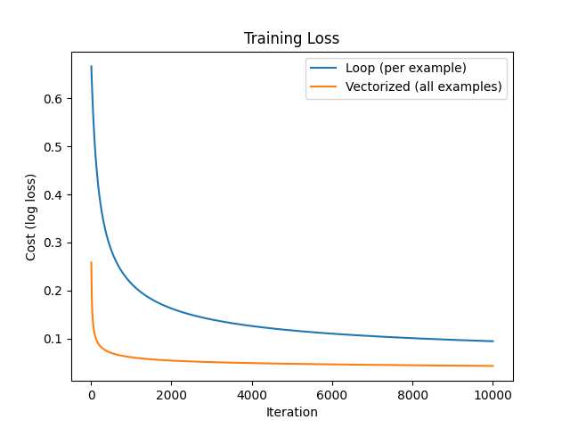

# Manual-Logistic-Regression

This is a manual implementation of a logistic regression model in Python, built to better understand how logistic regression models work. The dataset used is from the Wisconsin breast cancer dataset from scikit-learn.

The model is written from scratch with NumPy and trained with gradient descent. scikit-learn is only used to load the data, split it, standardize the features, and check the results.

## How it works

- **Sigmoid and log loss:** The model's guess is `sigmoid(X · W + b)`, and the cost is the average log loss over the training set.
- **Two ways of training:**
  - **Loop (per example):** goes through the training examples one at a time and updates the weights after each one.
  - **Vectorized (all examples):** uses matrix operations to compute the gradient for every training example at once, then updates the weights once per iteration.
- **Feature scaling:** The features are standardized, with the scaler fit on the training set only so no information from the testing set leaks in.
- **Evaluation:** The data is split 80/20 into training and testing sets with a fixed random seed, so the results are the same every run. The model is compared against scikit-learn's `LogisticRegression` on the same split.

## Results

Testing set: 114 examples. In this dataset, 0 = malignant and 1 = benign. Precision and recall are reported for the malignant class, since missing a malignant tumour is the costly mistake.

| Model | Accuracy | Precision (malignant) | Recall (malignant) |
|---|---|---|---|
| Manual, loop (per example) | 99.1% | 100% | 97.7% |
| Manual, vectorized (all examples) | 98.2% | 97.7% | 97.7% |
| scikit-learn `LogisticRegression` | 97.4% | 97.6% | 95.3% |

The vectorized version trained about **110x faster** than the loop version (~0.12 s vs. ~13 s for 10,000 iterations).



## How to run

```
pip install -r requirements.txt
python "Manual Logistic Regression Model.py"
```

The script prints the cost every 10 iterations, then the results above, and shows the loss curve.
